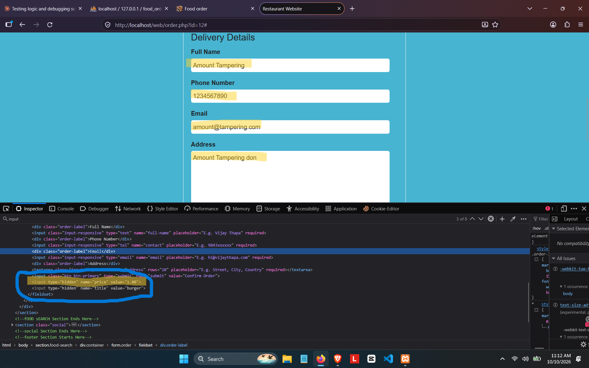
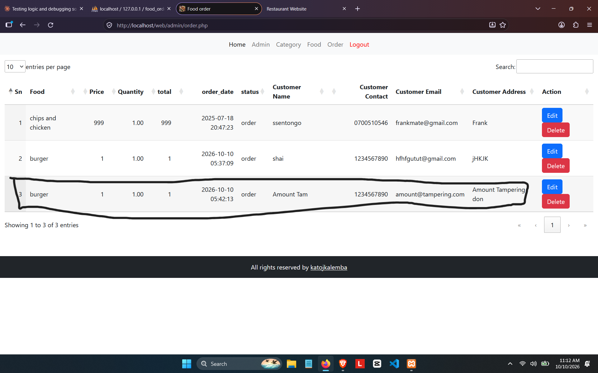

# sourcecodester Online Food Ordering System in PHP and MySQL Source Code — Order Price/Amount Tampering via Hidden Form Fields

## Vendor

sourcecodester

## Product

Online Food Ordering System in PHP and MySQL Source Code  
Product URL: https://www.sourcecodester.com/php/18232/food-order-system.html

## Vulnerability

The order handler trusts the submitted product price instead of calculating it from the server-side product record. A customer can tamper with the order amount (CWE-602).

**Discovered by:** Shailendra Mourya (CyberShailendra)  
**Affected file:** `order.php`  
**Report date:** 2026-10-10  
**Status:** Reported as reproduced on a local XAMPP test instance.

---

## Finding Details

| Field | Value |
|---|---|
| **Title** | Online Food Ordering System `order.php` Client-Side Price Trust / Business Logic Tampering |
| **Affected File** | `order.php` |
| **Vulnerability Type** | Improper Trust of Client-Submitted Data (CWE-602) / Business Logic Error |
| **Attack Vector** | Network (remote) |
| **Authentication Required** | None — public ordering page |
| **CVSS 3.1 Vector (estimated)** | AV:N/AC:L/PR:N/UI:N/S:U/C:N/I:H/A:N |
| **CVSS 3.1 Score (estimated)** | 7.1 (High) |
| **Root Cause** | The food `price` and `title` are rendered into hidden form fields, then the server blindly trusts the POSTed values instead of re-reading the authoritative records from the database before calculating the order total. |
| **Proof of Concept** | Open `order.php?id=16`, edit the hidden `price` field in DevTools from `12300` to `1`, and submit the order. |
| **Observed Impact** | A customer can place an order for a product at an arbitrary near-zero price, resulting in lost revenue and fraudulent transactions. |
| **Confirmed By** | User, local XAMPP instance, 2026-10-10 — hidden price value was modified and the order was accepted at the altered amount. |
| **Remediation** | Never trust client-supplied pricing/title values. On submission, fetch the product from `tbl_food` again by `id` and compute totals server-side from the database record only. |

---

## Evidence Screenshots







## Technical Details — Vulnerable Code (`order.php`)

```php
<?php
    $id = $_GET['id'];
    $sql = "select * from tbl_food where id=$id";       // SQLi issue also present in this flow
    $execute = mysqli_query($conn, $sql);
    $fetch = mysqli_fetch_assoc($execute);
?>

<form method="POST">
    <input type="hidden" name="price" value="<?php echo $fetch['price'] ?>">
    <input type="hidden" name="title" value="<?php echo $fetch['title'] ?>">
    ...
</form>

<?php
if(isset($_POST['submit'])){
    $price = $_POST['price'];      // <-- attacker-controlled client input
    $title = $_POST['title'];      // <-- attacker-controlled client input
    $qty   = $_POST['qty'];
    $total = $price * $qty;        // <-- computed from manipulated data

    $sql = "insert into tbl_order set customer_name='...', title='$title', price='$price', qty='$qty', total='$total', ...";
    mysqli_query($conn, $sql);
}
?>
```

The form sends the food ID, price, and title back to the server. The handler uses the submitted price and title without looking up the current product record again, so changing the hidden values in the browser can change what is recorded for the order.

---

## Root Cause Analysis

The hidden fields are user-controlled input, not a reliable source for prices. Because the ordering page is public, an unauthenticated customer can submit modified values unless the server retrieves the price from the database when processing the order.

---

## Remediation Code

```php
<?php
if(isset($_POST['submit'])){
    $food_id = intval($_POST['food_id']);
    $qty = max(1, intval($_POST['qty']));

    // Re-fetch the authoritative record from the database
    $sql = "SELECT title, price FROM tbl_food WHERE id=? AND active='yes'";
    $stmt = mysqli_prepare($conn, $sql);
    mysqli_stmt_bind_param($stmt, "i", $food_id);
    mysqli_stmt_execute($stmt);
    $result = mysqli_stmt_get_result($stmt);
    $food = mysqli_fetch_assoc($result);

    if(!$food){
        $errors[] = "Selected food is not available";
    } else {
        $title = $food['title'];
        $price = (float) $food['price'];
        $total = $price * $qty; // computed server-side only

        $ins = "INSERT INTO tbl_order SET customer_name=?, title=?, price=?, qty=?, total=?";
        $stmt2 = mysqli_prepare($conn, $ins);
        mysqli_stmt_bind_param($stmt2, "ssdid", $customer_name, $title, $price, $qty, $total);
        mysqli_stmt_execute($stmt2);
    }
}
?>
```

The safest fix is to remove hidden `price` and `title` inputs entirely, keep only the `food_id`, and regenerate the total from the database record on the server.

---

## Summary

This vulnerability allows any user to manipulate the amount charged for a food item by altering the form data in a browser. Because the server does not re-validate the price, the order is accepted with the tampered value. This results in unauthorized discounting, business losses, and potential abuse of the public ordering workflow.

---

